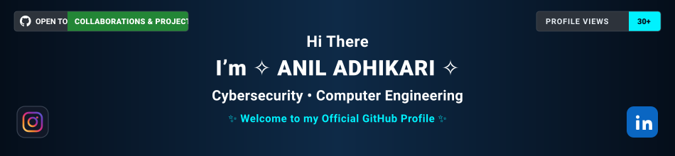

<!-- ======================================================== -->
<!-- 🚀 ANIL ADHIKARI - PROFESSIONAL GITHUB PROFILE README   -->
<!-- Cybersecurity | Computer Engineering                    -->
<!-- ======================================================== -->

<div align="center">
  <!-- 🚀 Custom Master Header Banner: 100% Matching Visual Concept -->
  <a href="https://anil-adhikari.com.np/"></a><a href="https://anil-adhikari.com.np/"></a><!-- 📈 Live Dynamic Profile Views Increment Tracker (Increments on every profile visit) -->

  <br/>

  <!-- Connect With Me - Circle Style Social Icons -->
  <p align="center">
    <a href="https://www.linkedin.com/in/aniladhikaritech/" target="_blank" rel="noreferrer" title="LinkedIn">
      
    </a>
    &nbsp;&nbsp;
    <a href="https://anil-adhikari.com.np/" target="_blank" rel="noreferrer" title="Website Portfolio">
      
    </a>
    &nbsp;&nbsp;
    <a href="https://www.credly.com/users/aniladhikari/badges/credly" target="_blank" rel="noreferrer" title="Credly Badges">
      
    </a>
    &nbsp;&nbsp;
    <a href="mailto:aniladhikari870@gmail.com" title="Email Me">
      
    </a>
    &nbsp;&nbsp;
    <a href="https://github.com/aniladhikaritech" target="_blank" rel="noreferrer" title="GitHub">
      
    </a>
    &nbsp;&nbsp;
    <a href="https://www.instagram.com/aniladhikaritech/" target="_blank" rel="noreferrer" title="Instagram">
      
    </a>
    &nbsp;&nbsp;
    <a href="https://www.facebook.com/AnilAdhikari.350123/" target="_blank" rel="noreferrer" title="Facebook">
      
    </a>
    &nbsp;&nbsp;
    <a href="https://discord.gg/dCqaE7k3Aq" target="_blank" rel="noreferrer" title="Discord">
      
    </a>
    &nbsp;&nbsp;
    <a href="https://t.me/AnilAdhikari1" target="_blank" rel="noreferrer" title="Telegram">
      
    </a>
  </p>
</div>

---

### ✍️ Short Introduction

> **"I am an energetic multitasker dedicated to learning something new every single day."**  
> Based in **Kathmandu, Nepal**, I am currently pursuing **BSc (Hons) Ethical Hacking & Cybersecurity** alongside my deep academic background in **Computer Engineering**. I currently work as a **Web Developer Intern at Softechpark Company** & design with **Figma**, while actively mastering **Google IT Automation with Python Professional**.  
>
> My passion bridges offensive & defensive cybersecurity, hands-on penetration testing labs, microcomputer architecture, structured network cabling, hardware security research with Arduino BadUSB, and full-stack web applications. I strive to sharpen my skills, solve challenging problems, and build reliable digital solutions.

---

### 🙇 About Me

```yaml
Name: Anil Adhikari
Location: Kathmandu, Nepal 🇳🇵
Field: Cybersecurity, Digital Forensics, Computer Engineering & Web Development
Degree: BSc (Hons) Ethical Hacking & Cybersecurity | Diploma in Computer Engineering
Current Role: Web Developer Intern @ Softechpark Company & Figma Prototyping
Certifications: (ISC)² CC | Cisco Ethical Hacker | Cisco Networking & OS | APIsec ACP
Current Goal: Mastering Google IT Automation with Python Professional & Advanced VAPT
```

- 🔭 **I’m currently working on**: Web Development & UI/UX prototyping at **Softechpark Company**, building modern web tools & interactive web applications.
- 🌱 **I’m currently learning**: **Google IT Automation with Python Professional**, AI-driven SOC operations, and advanced network penetration testing.
- 👯 **I’m looking to collaborate on**: Open-source Security Tools, VAPT Labs, Hardware Hacking (Arduino BadUSB / HID Injection), and Python Automation pipelines.
- 🤝 **I’m looking for help with**: Cloud Penetration Testing, Binary Exploitation, and Red Teaming methodologies.
- 👨‍💻 **All of my projects are live at**: [anil-adhikari.com.np](https://anil-adhikari.com.np/) and on my [GitHub Repositories](https://github.com/aniladhikaritech?tab=repositories).
- 💬 **Ask me about**: **Cybersecurity & Ethical Hacking**, **Computer Hardware & Networking**, **Cisco Packet Tracer**, **Python**, **JavaScript**, **React**, and **HTML5/CSS3**.
- 📫 **How to reach me**: Drop an email at **[aniladhikari870@gmail.com](mailto:aniladhikari870@gmail.com)** or connect on **[LinkedIn](https://www.linkedin.com/in/aniladhikaritech/)**.
- ⚡ **Fun fact**: *A person with a happy personality and a heavy soul—sometimes it gets weird, but I'm always fueled by black coffee, terminal screens, packet captures, and microcontrollers!* ☕⚡

---

### 🏆 Industry Certifications & Credentials

| Credential | Issuer | Verification |
| :--- | :---: | :---: |
| 🛡️ **Certified in Cybersecurity™ (CC)** | **(ISC)²** | [Verify Credly](https://www.credly.com/users/aniladhikari/badges/credly) |
| 🔴 **Cisco Ethical Hacker** | **Cisco Networking Academy** | [Verify Credly](https://www.credly.com/users/aniladhikari/badges/credly) |
| 🌐 **Cisco Introduction to Cybersecurity** | **Cisco** | [Verify Credly](https://www.credly.com/users/aniladhikari/badges/credly) |
| 💻 **Cisco Operating Systems Basics** | **Cisco** | [Verify Credly](https://www.credly.com/users/aniladhikari/badges/credly) |
| 🎯 **APIsec Certified Practitioner (ACP)** | **APIsec University** | [Verify APIsec](https://university.apisec.ai/products/apisec-certified-practitioner) |
| 🔍 **Introduction to Ethical Hacking** | **Great Learning** | [Verify GL](https://verify.mygreatlearning.com/GRLFARUI) |
| 🤖 **TechSense AI & Cybersecurity Capstone** | **Softwarica College & IoA** | Endorsed by IoA (DeepGuard AI) |
| 🚀 **Universal Acceptance Hackathon Nepal** | **ICANN & CAN Federation** | Pioneering UA-Ready Platforms |
| ⚡ **Flash Hack — EU Youth Fest Hackathon** | **European Union (UDAAN)** | Rapid Innovation Prototyping |
| 🛠️ **5-Month Computer Engineering OJT** | **Bal Uddhar Secondary School** | Hardware, Cabling & Network Admin |

---

### 🛠️ Languages, Tools & Technologies

<div align="center">

#### 🛡️ Cybersecurity, Forensics & Ethical Hacking
<p>
  
  
  
  
  
  
  
  
</p>

#### 💻 Programming & Scripting Languages
<p>
  
  
  
  
  
  
  
  
  
</p>

#### 🌐 Web Development & Frameworks
<p>
  
  
  
  
  
  
</p>

#### 🔌 Computer Hardware, Networking & Microcontrollers
<p>
  
  
  
  
  
  
  
</p>

#### 🎨 UI/UX & Graphic Design
<p>
  
  
  
  
  
</p>

#### ☁️ DevOps, Systems & Cloud Tools
<p>
  
  
  
  
  
  
  
  
</p>

</div>

---

### 👨‍💻 Featured Projects

<table>
  <tr>
    <td width="50%" valign="top">
      <h3 align="center">🛡️ DeepGuard: Deepfake Forensics</h3>
      <p align="center">
        
        
      </p>
      <p>AI-driven deepfake detection and synthetic media forensic framework. Utilizes spatial frequency decomposition and facial artifact tracking to identify neural manipulation.</p>
      <ul>
        <li><b>Tech:</b> Python, PyTorch, OpenCV, Forensic Analysis</li>
        <li><b>Endorsement:</b> Institute of Analytics (IoA) Capstone</li>
      </ul>
      <p align="center">
        <a href="https://github.com/aniladhikaritech"><b>View Project ➔</b></a>
      </p>
    </td>
    <td width="50%" valign="top">
      <h3 align="center">🤖 AI-Enhanced SecOps Operations</h3>
      <p align="center">
        
        
      </p>
      <p>Modern Security Operations Center (SOC) framework leveraging Machine Learning to prioritize high-risk threat vectors, filter noise, and automate incident triage.</p>
      <ul>
        <li><b>Tech:</b> Python, SIEM, SOC Automation, Threat Scoring</li>
        <li><b>Impact:</b> 75% alert fatigue reduction in simulated SOC</li>
      </ul>
      <p align="center">
        <a href="https://github.com/aniladhikaritech/Prioritizing-AI-to-Enhance-Security-Operations-SecOps"><b>View Repository ➔</b></a>
      </p>
    </td>
  </tr>
  <tr>
    <td width="50%" valign="top">
      <h3 align="center">🔌 Arduino BadUSB & HID Pentesting</h3>
      <p align="center">
        
        
      </p>
      <p>Hardware penetration testing platform engineered on Arduino Pro Micro (ATmega32U4) microcontrollers to test physical security attack vectors and USB endpoint defense policies.</p>
      <ul>
        <li><b>Tech:</b> C++, DuckyScript, HID Payloads, USB Security</li>
        <li><b>Features:</b> Proof-of-concept automated test payloads</li>
      </ul>
      <p align="center">
        <a href="https://anil-adhikari.com.np/"><b>Explore Hardware Lab ➔</b></a>
      </p>
    </td>
    <td width="50%" valign="top">
      <h3 align="center">🌐 Enterprise Multi-VLAN Network</h3>
      <p align="center">
        
        
      </p>
      <p>Enterprise Cisco topology with inter-VLAN routing, port security against MAC flooding, dynamic ARP inspection, and access control lists (ACLs) isolating sensitive segments.</p>
      <ul>
        <li><b>Tech:</b> Cisco IOS, Packet Tracer, VLANs, ACLs, DHCP Snooping</li>
        <li><b>Topology:</b> 6 Subnets, 8 Managed Switches, 4 Border Routers</li>
      </ul>
      <p align="center">
        <a href="https://github.com/aniladhikaritech"><b>View Topology ➔</b></a>
      </p>
    </td>
  </tr>
  <tr>
    <td width="50%" valign="top">
      <h3 align="center">🩸 Blood Bank Management System</h3>
      <p align="center">
        
        
      </p>
      <p>Full-stack institutional database management system deployed during a 5-month Computer Engineering apprenticeship with complete structured Ethernet cabling laboratory setup.</p>
      <ul>
        <li><b>Tech:</b> PHP, MySQL, Apache, Structured Cabling (T568B)</li>
        <li><b>Scope:</b> 40+ networked laboratory workstations</li>
      </ul>
      <p align="center">
        <a href="https://anil-adhikari.com.np/"><b>Read Technical Report ➔</b></a>
      </p>
    </td>
    <td width="50%" valign="top">
      <h3 align="center">⚡ Modern Cybersecurity Portfolio</h3>
      <p align="center">
        
        
      </p>
      <p>High-performance production portfolio featuring real-time cyber threat ticker, interactive hardware payload inspector, instant 0ms multi-language translation, and dark glassmorphic design.</p>
      <ul>
        <li><b>Tech:</b> React 19, Tailwind CSS, Vite, Lucide</li>
        <li><b>Live Demo:</b> <a href="https://anil-adhikari.com.np/">anil-adhikari.com.np</a></li>
      </ul>
      <p align="center">
        <a href="https://github.com/aniladhikaritech/Portfolio-Website"><b>View Source Code ➔</b></a>
      </p>
    </td>
  </tr>
</table>

<details>
  <summary><b>🛠️ Click to expand: Everyday Utility Web Tools I've Built & Maintained</b></summary>
  <br/>
  <ul>
    <li>🚀 <b>Tik-Tok Video Downloader:</b> Clean downloader tool without watermark.</li>
    <li>🗜️ <b>Online Video Compressor:</b> In-browser lightweight video compression utility.</li>
    <li>📅 <b>Date & Time Converter:</b> Bikram Sambat (BS) to Anno Domini (AD) conversion engine.</li>
    <li>🔐 <b>Cryptographic Password Generator:</b> Configurable entropy and symbol password tool.</li>
    <li>🔢 <b>Number to Words / Words to Number Converter:</b> Fast international & South Asian numbering utility.</li>
    <li>📱 <b>Custom QR Code Generator:</b> Instant WiFi, URL, and vCard QR generator with styling.</li>
    <li>🎵 <b>MP3 ⇄ MP4 Converter:</b> Multi-format media converter utility.</li>
  </ul>
</details>

---

### 📊 GitHub Activity & Statistics

<div align="center">
  <!-- GitHub Overall Stats & Top Languages Side-by-Side -->
  <a href="https://github.com/aniladhikaritech">
    
  </a>
  <a href="https://github.com/aniladhikaritech">
    
  </a>
  
  <br/><br/>

  <!-- GitHub Streak Stats -->
  <a href="https://github.com/aniladhikaritech">
    
  </a>

  <br/><br/>

  <!-- GitHub Activity Contribution Graph -->
  <a href="https://github.com/aniladhikaritech">
    
  </a>

  <br/><br/>

  <!-- GitHub Profile Trophy -->
  <a href="https://github.com/aniladhikaritech">
    
  </a>
</div>

---

### 🎖️ GitHub Achievements & Program Badges

<div align="center">
  
  
  
  
  
  
</div>

---

### 🤝 Let's Connect & Collaborate!

I'm always open to discussing **Cybersecurity Research**, **Penetration Testing**, **Network Architectures**, **Web Development Projects**, or **Exciting Tech Opportunities**.

<div align="center">
  <p>
    <a href="https://www.linkedin.com/in/aniladhikaritech/" target="_blank" rel="noreferrer" title="LinkedIn">
      
    </a>
    &nbsp;&nbsp;
    <a href="https://anil-adhikari.com.np/" target="_blank" rel="noreferrer" title="Website Portfolio">
      
    </a>
    &nbsp;&nbsp;
    <a href="https://www.credly.com/users/aniladhikari/badges/credly" target="_blank" rel="noreferrer" title="Credly Badges">
      
    </a>
    &nbsp;&nbsp;
    <a href="mailto:aniladhikari870@gmail.com" title="Email Me">
      
    </a>
    &nbsp;&nbsp;
    <a href="https://github.com/aniladhikaritech" target="_blank" rel="noreferrer" title="GitHub">
      
    </a>
    &nbsp;&nbsp;
    <a href="https://www.instagram.com/aniladhikaritech/" target="_blank" rel="noreferrer" title="Instagram">
      
    </a>
    &nbsp;&nbsp;
    <a href="https://www.facebook.com/AnilAdhikari.350123/" target="_blank" rel="noreferrer" title="Facebook">
      
    </a>
    &nbsp;&nbsp;
    <a href="https://discord.gg/dCqaE7k3Aq" target="_blank" rel="noreferrer" title="Discord">
      
    </a>
    &nbsp;&nbsp;
    <a href="https://t.me/AnilAdhikari1" target="_blank" rel="noreferrer" title="Telegram">
      
    </a>
  </p>
</div>

<br/>

<div align="center">
  <!-- Dynamic Footer Wave -->
  <a href="https://anil-adhikari.com.np/">
    
  </a>
  <p align="center">
    <i>"Continuous learning, ethical integrity, and technological innovation."</i><br/>
    <a href="https://anil-adhikari.com.np/" target="_blank" rel="noreferrer" title="Anil Adhikari Portfolio">
      
    </a>
  </p>
</div>
